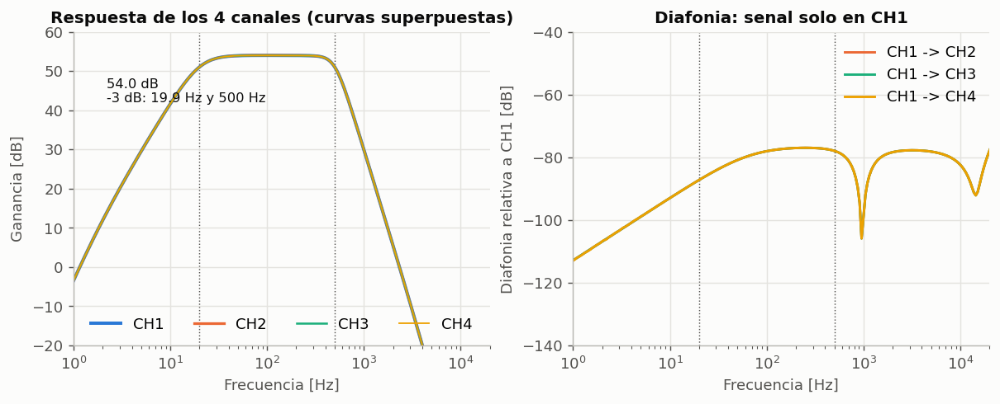
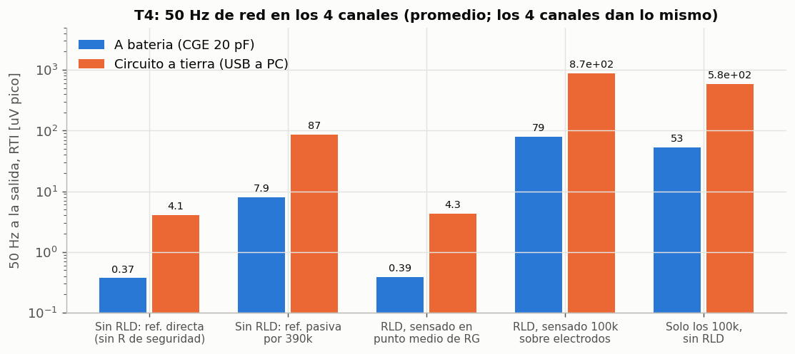
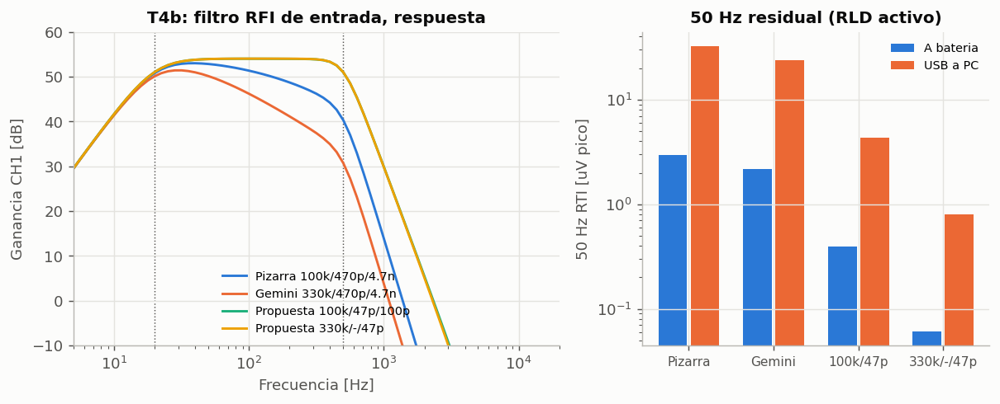
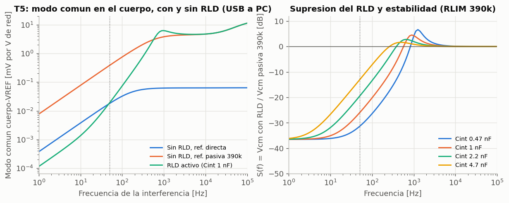
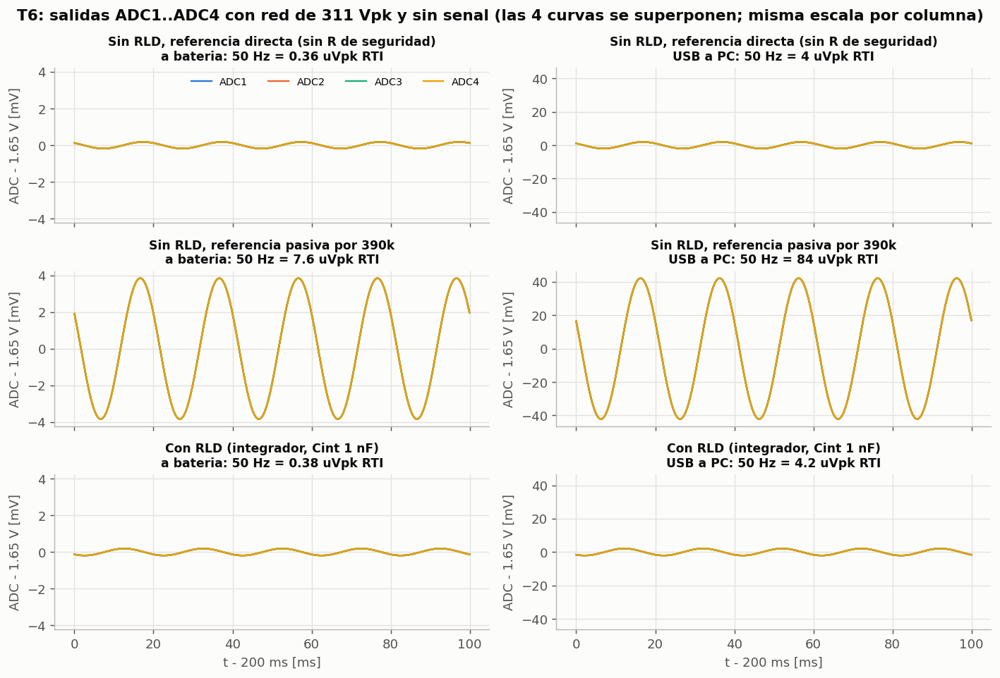
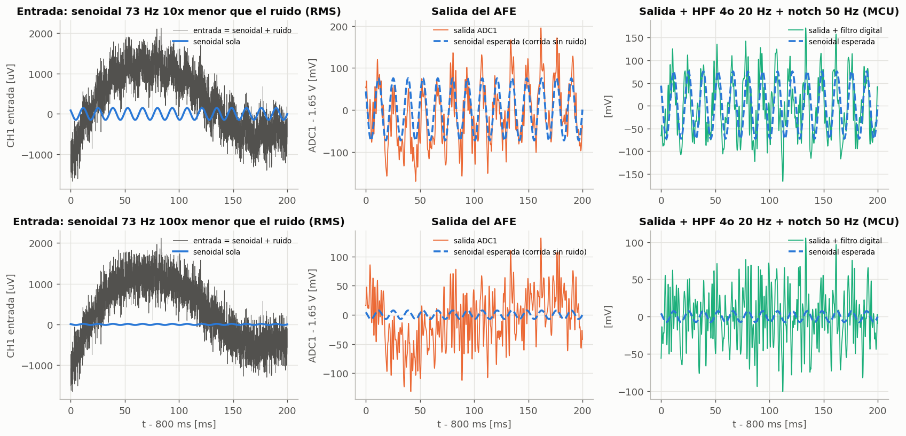
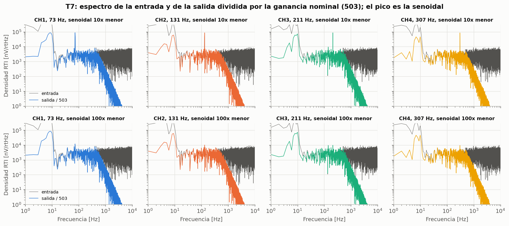
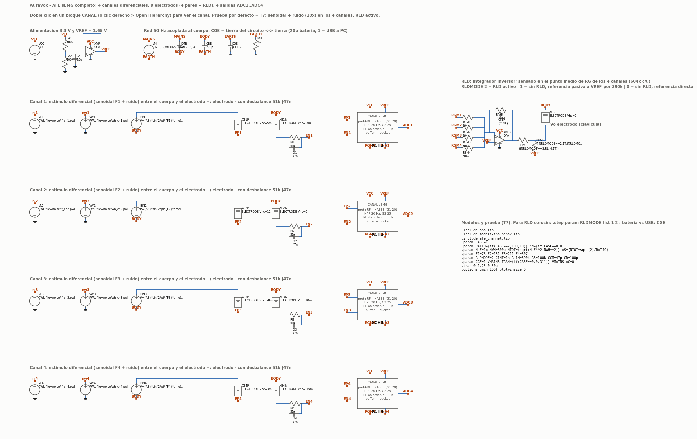
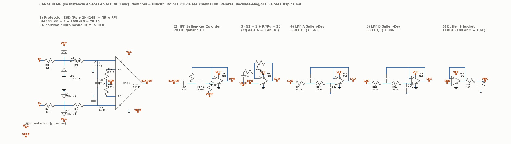

# AFE sEMG: resultados de simulación LTspice (4 canales)

Simulación del AFE completo: **4 canales diferenciales, 9 electrodos (4 pares + RLD) y 4 salidas ADC1..ADC4**, con un RLD compartido y un modelo de cuerpo y red de 50 Hz. Valores de componentes: `AFE_valores_ltspice.md`. Archivos: `sim/ltspice/`. Fecha: 27 sep 2026.

---

## 1. Cómo verlo y correrlo

**Esquemático (GUI).** En una terminal:

```bash
cd ~/SSI/sim/ltspice
wine "C:\Program Files\ADI\LTspice\LTspice.exe" AFE_4CH.asc
```

- Se abre el nivel superior: 4 bloques `CANAL`, 9 electrodos, RLD, VREF, cuerpo, red y estímulos. Doble clic en un bloque `CANAL` (o clic derecho > *Open Hierarchy*) muestra un canal completo.
- **Run** corre la prueba T7 (senoidal + ruido, 1,25 s, unos 6 min). Después, clic sobre un nodo grafica su tensión: `ADC1`..`ADC4` son las salidas.
- Para comparar con y sin RLD, cambiar `.param RLDMODE=2` por `.step param RLDMODE list 1 2`.

**Netlists (batch).** Cada prueba es un `.cir` de texto. Se abre igual en la GUI (File > Open, tipo *Netlists*) o se corre sin ventana:

```bash
wine "C:\Program Files\ADI\LTspice\LTspice.exe" -b t4_cm.cir   # resultados de .meas en t4_cm.log
python3 tools/run.py t2_ac.cir t4_cm.cir t4b_rfi.cir t5_rld.cir
python3 tools/run.py --unroll -j 3 t6_rld_tran.cir t7_func.cir  # un proceso por paso, en paralelo
python3 tools/make_figs.py                                      # figuras y metricas.json en docs/afe-emg/figs/
```

| Archivo | Qué es |
|---|---|
| `AFE_4CH.asc`, `CANAL.asc` (+ `.asy`) | Esquemáticos jerárquicos, generados por `tools/make_asc.py`. `tools/check_asc.py` confirma que su conectividad es idéntica a la de los netlists (36 elementos por canal, 52 en el nivel superior) |
| `afe_channel.lib` | Un canal (subcircuito `AFE_CH`), electrodo y generador de VREF |
| `afe_4ch_top.inc` | Banco completo: 4 canales, 9 electrodos, RLD, cuerpo y red |
| `t2_ac` … `t7_func` | Pruebas (sección 3) |
| `opa.lib`, `ina.lib` | Selectores de modelo (sección 2) |
| `noise/` | Ruido de T7 (generado por `tools/gen_noise.py`, semilla fija) |

---

## 2. Modelos

| Pieza | Modelo | Nota |
|---|---|---|
| INA333, análisis AC | Macromodelo TI (SBOM382, Final 1.3) | `models/INA333.LIB` |
| INA333, transitorios largos (T6, T7) | Equivalente `models/ina_behav.lib` | Misma topología de 3 op-amps, red resistiva (con el desajuste de R6), capacidades, corrientes de polarización y Vos del modelo TI; solo los 3 amplificadores internos son celdas suaves. El macromodelo TI obliga a pasos de ~50 ns y 1 s con 4 canales tardaba horas |
| MCP6004 | Conductual `models/opa_behav.lib` | GBW 1 MHz, Aol 112 dB, SR 0,6 V/µs, salida a 25 mV de los rieles. Validado: GBW 1,00 MHz y SR 0,600 V/µs medidos |
| MCP6004, macromodelo Microchip | `models/opa_mcp.lib` → `models/MCP6001.lib` | **Pendiente del archivo oficial** (sección 5) |

Validación del INA333 equivalente contra el de TI (G = 20, `dbg/ina_cmp.cir`):

| | TI | Equivalente |
|---|---|---|
| Ganancia a 100 Hz | 20,157 | 20,157 |
| Ancho de banda −3 dB | 28,2 kHz | 28,2 kHz |
| Fase a 500 Hz | −1,30° | −1,19° |
| CMRR a 50 Hz / 1 kHz / 10 kHz | 114,2 / 92,6 / 72,0 dB | 114,2 / 92,6 / 72,1 dB |

El ruido propio de los componentes no entra en los transitorios; se evalúa con `.noise` (pendiente, T6 del plan original).

---

## 3. Resultados

### T2: respuesta en frecuencia de los 4 canales (`t2_ac.cir`)



- Los 4 canales: **54,01 dB (×503)**, −3 dB en **19,9 Hz y 500 Hz**; las 4 curvas coinciden (54,008 dB a 100 Hz en cada una).
- Diafonía con señal solo en CH1: **−78 dB** en banda. La vía es el RLD: la mitad de la señal de CH1 aparece como modo común en su punto medio de RG, el RLD la reinyecta al cuerpo y el desbalance de electrodos de los otros canales la convierte en diferencial. Es despreciable.

### T4: 50 Hz de red, sensado del RLD y RLD con/sin (`t4_cm.cir`)

Red de 311 Vpk acoplada al cuerpo (3 pF), desbalance de electrodo 51k ∥ 47n en cada canal, 4 canales sin señal. RTI = salida / 503.



| Variante | A batería | USB a PC (circuito a tierra) |
|---|---|---|
| Sin RLD, referencia directa a VREF (sin R de seguridad) | 0,37 µVpk | 4,1 µVpk |
| Sin RLD, referencia pasiva por 390 kΩ | 7,9 µVpk | 87 µVpk |
| **RLD, sensado en punto medio de RG** | **0,39 µVpk** | **4,3 µVpk** |
| RLD, sensado con 100k × 8 sobre electrodos (pizarra) | 79 µVpk | 869 µVpk |
| Solo los 100k × 8, sin RLD | 53 µVpk | 581 µVpk |

- **Sensado:** el punto medio de RG es ~200 veces (46 dB) mejor que sensar con 100k sobre los electrodos. Los 100k cargan cada electrodo y convierten el modo común en diferencial a través del desbalance; ese error lo produce la sola presencia de los resistores (fila "Solo los 100k").
- **Con RLD contra sin RLD:** frente a una referencia pasiva con la misma resistencia de seguridad (390 kΩ), el RLD reduce el 50 Hz **20 veces (26 dB)**. Frente a una referencia conectada directo a VREF sin resistencia queda igual (4,3 contra 4,1 µV), pero esa conexión directa no limita la corriente al paciente ante una falla, así que no es una alternativa válida.
- A batería el 50 Hz es 10 veces menor que conectado a un PC por USB, porque el circuito flota.

### T4b: variantes del filtro RFI de entrada (`t4b_rfi.cir`)



| Filtro | Pérdida a 100 Hz | Pérdida a 500 Hz | 50 Hz RTI, batería / USB |
|---|---|---|---|
| Pizarra: 100k, 470p, 4,7n | −2,7 dB | **−10,7 dB** | 2,9 / 32 µVpk |
| Gemini: 330k, 470p, 4,7n | −7,8 dB | **−20,3 dB** | 2,2 / 24 µVpk |
| 100k, 47p, 100p | 0 | 0 | 0,39 / 4,3 µVpk |
| **330k, sin Ccm, 47p** | 0 | 0 | **0,06 / 0,8 µVpk** |

Las dos variantes con 470 pF + 4,7 nF recortan la banda útil. La de **330k sin Ccm y Cd 47 pF** conserva la banda y da el menor 50 Hz: es la recomendada (decisión del usuario).

### T5 y T6: RLD con y sin

**En frecuencia** (`t5_rld.cir`, USB a PC). Izquierda: modo común en el cuerpo por cada volt de red. Derecha: supresión del RLD relativa a la referencia pasiva de 390k, para 4 valores de Cint.



| Cint | Supresión a 50 Hz | Pico (estabilidad) | Margen de fase estimado |
|---|---|---|---|
| 470 pF | −31,4 dB | +6,7 dB a 1,26 kHz | ≥ 27° |
| **1 nF** | **−26,1 dB** | **+4,5 dB a 0,9 kHz** | **≥ 35°** |
| 2,2 nF | −19,6 dB | +2,8 dB a 0,6 kHz | ≥ 42° |
| 4,7 nF | −13,1 dB | +1,6 dB a 0,5 kHz | ≥ 49° |

Margen estimado a partir del pico de sensibilidad (MF ≥ 2·asin(1/(2·|S|máx))). Con 1 nF el lazo es estable, con margen justo: un pico de +4,5 dB entre 0,6 y 2 kHz amplifica ahí el modo común, aunque en esa zona el filtro de 500 Hz ya lo atenúa. Si en el banco aparece sobreimpulso, **2,2 nF** es el siguiente paso, a cambio de 6,5 dB menos de supresión a 50 Hz. El cruce del lazo (~1 kHz) está muy por debajo del GBW del MCP6004, así que el modelo de op-amp casi no influye aquí.

**En el tiempo** (`t6_rld_tran.cir`): salidas ADC1..ADC4 con la red de 311 Vpk y sin señal; las 4 curvas se superponen.



| | A batería | USB a PC |
|---|---|---|
| Sin RLD, referencia directa | 0,36 µVpk | 3,95 µVpk |
| Sin RLD, referencia pasiva 390k | 7,6 µVpk (3,8 mVpk en el ADC) | 84 µVpk (42 mVpk en el ADC) |
| **Con RLD** | **0,38 µVpk** | **4,2 µVpk (2,1 mVpk en el ADC)** |

Coincide con el análisis AC de T4, con un modelo distinto del INA333 (el equivalente), lo que también valida ese equivalente para el 50 Hz.

### T7: prueba funcional, senoidal + ruido en los 4 canales (`t7_func.cir`)

**Entrada de cada canal:** una senoidal (73, 131, 211 y 307 Hz en CH1..CH4) más ruido diferencial. El ruido tiene dos componentes: un artefacto de movimiento gaussiano de 0,1–10 Hz con 1 mV RMS y ruido blanco gaussiano hasta ~8 kHz con 0,3 mV RMS, en total **1,04 mV RMS**. La senoidal es **10 y 100 veces menor que ese ruido** (RMS). Además actúan la media celda DC de cada electrodo (±15 mV) y la red de 311 Vpk por el cuerpo, con el circuito a tierra (peor caso) y el RLD activo.





| | Senoidal 10× menor | Senoidal 100× menor |
|---|---|---|
| SNR a la entrada (banda ancha) | −20 dB | −40 dB |
| SNR a la salida del AFE | −1,1 a −3,5 dB | −19,8 a −21,6 dB |
| SNR de un AFE ideal con la misma respuesta | igual (±0,1 dB) | igual (±0,1 dB) |
| SNR a la salida + filtro digital (HPF 4º orden 20 Hz + notch 50 Hz) | +4,1 a +4,4 dB | −14,2 a −14,5 dB |
| Ganancia de la senoidal contra la corrida sin ruido | ±0,9 % | ±4 % (la estimación incluye el ruido que cae en la misma frecuencia) |

Composición del ruido que queda a la salida (referido a la entrada, igual en ambos casos):

| Canal | Total | Artefacto de movimiento (5–20 Hz que pasa el HPF) | Ruido blanco dentro de 20–500 Hz | 50 Hz de red |
|---|---|---|---|---|
| CH1 | 136 µV RMS | 119 µV | 66 µV | 3,9 µVpk |
| CH2 | 131 µV RMS | 112 µV | 66 µV | 4,6 µVpk |
| CH3 | 159 µV RMS | 145 µV | 66 µV | 5,5 µVpk |
| CH4 | 119 µV RMS | 101 µV | 63 µV | 4,0 µVpk |

Lectura:

- **El AFE funciona en los 4 canales.** Entrega la senoidal con la ganancia correcta, sin saturar ni distorsionar, aun con ±15 mV de offset de electrodo, 1 mV de artefacto y la red por el cuerpo. La SNR medida es exactamente la que da su función de transferencia lineal: el circuito no agrega nada que no esté en el diseño.
- La mejora de SNR (**+17 a +19 dB**) viene de eliminar lo que está fuera de 20–500 Hz: la mayor parte del artefacto de movimiento, el ruido blanco sobre 500 Hz y el modo común de 50 Hz.
- Lo que queda es ruido **dentro o al borde de la banda**. Ningún AFE analógico puede quitar el ruido blanco que ya viene dentro de 20–500 Hz; por eso, con la senoidal 100 veces menor, no se ve en el tiempo pero sí en el espectro (unos 10 dB sobre el piso con 1 s de ventana).
- **Hallazgo de diseño:** el componente dominante es el artefacto de movimiento entre ~5 y 20 Hz que deja pasar el HPF de 2º orden (−12 dB a 10 Hz). La solución más barata es un HPF digital de 4º orden en la MCU, que mejora la SNR en ~6 dB. La alternativa analógica es subir el HPF a 4º orden.
- El 50 Hz diferencial residual (4–5,5 µVpk RTI) es chico frente al ruido; igual conviene un notch digital, porque 50 Hz cae dentro de la banda y el AFE no lo puede filtrar como diferencial.

---

## 4. Esquemáticos

Vista previa generada desde los `.asc` (`tools/render_asc.py`); en LTspice se ven con los símbolos nativos.





---

## 5. Pendiente

- **Macromodelo oficial del MCP6004 (Microchip).** El archivo disponible era un espejo de GitHub modificado por un tercero ("Bordodynov"), con dos tablas con paréntesis mal balanceados; no convergía con varias instancias. Al tener el `.zip` oficial: poner su `.lib` como `models/MCP6001.lib`, activar `models/opa_mcp.lib` en `opa.lib` y volver a correr T2, T4, T5 y un T6/T7 corto.
- `.noise` (presupuesto de ruido real con el INA333 de TI), T3 (offset de electrodo y recuperación), Monte Carlo de tolerancias (RG 0,1 %, CMRR entre canales).
- Decisiones: filtro RFI (se recomienda 330k sin Ccm, Cd 47 pF), Cint del RLD (1 nF o 2,2 nF), HPF digital de 4º orden en la MCU.
